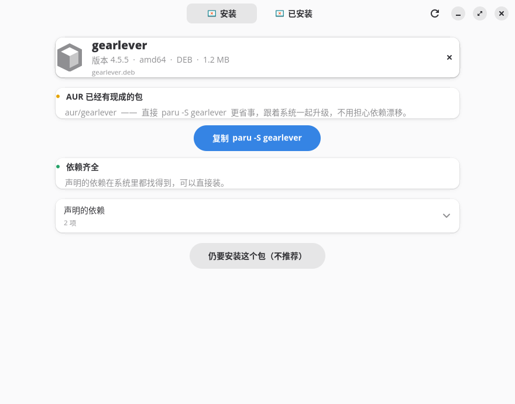
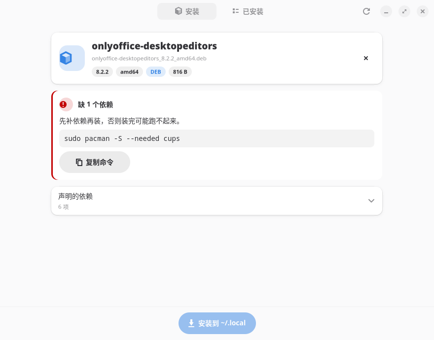
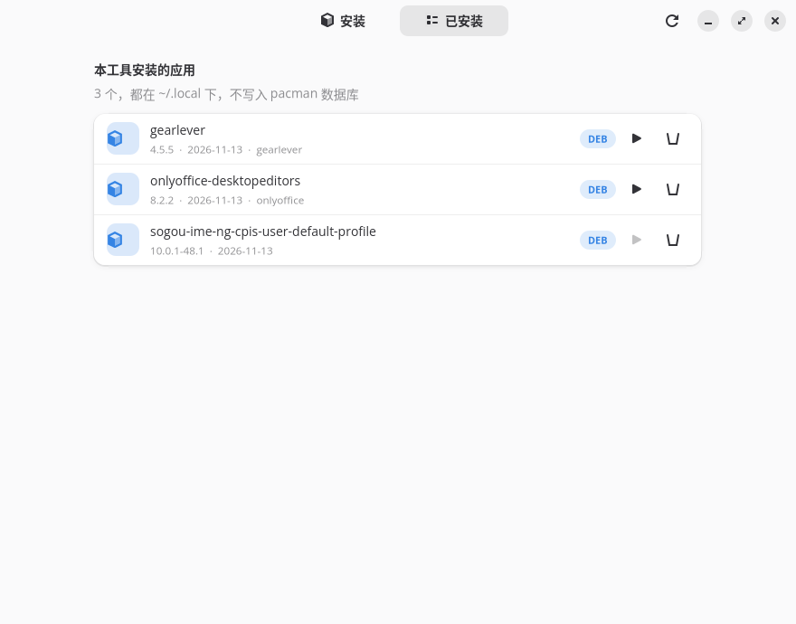

# pkg-installer

[](LICENSE)
[](https://archlinux.org)
[](https://gnome.org)


**在 Arch 上双击安装 `.deb`、`.rpm`、`.AppImage`、`.flatpak`，免 root，不污染 pacman 数据库。**

很多软件只发 `.deb` 或 `.rpm`。Arch 上你可能装了 `dpkg`，但 `/var/lib/dpkg/status` 是空的——`sudo dpkg -i` 会解包成功然后装出一个跑不起来的东西。rpm 更直接：Arch 根本不认它。

`.AppImage` 和 `.flatpak` 本来是「装」的概念之外的：前者是自带运行时的单文件程序，后者有自己的沙箱运行时。对它们这个工具做的是**登记**——把程序、图标、桌面条目接到你的应用菜单里，而不是把内容摊进 `~/.local/opt`。

这个工具换个思路：**不试图让 Arch 变成 Debian 或 Fedora，而是把包里自包含的那部分解出来，装进你的家目录。**



[English](#english)

## 它做三件事

**1. 先告诉你有没有更好的办法**

拿到一个包，它第一件事不是装，是去 `pacman` 官方库和 AUR 里搜同名包。搜到了就亮黄条：

> AUR 已有：`aur/gearlever` —— 直接 `paru -S gearlever` 更省事，跟着系统一起升级，不用担心依赖漂移。

旁边一个按钮，点了就把命令复制到剪贴板。**这是我最想要的行为**：绝大多数国产客户端在 AUR 或 Flathub 上都有，用原生的包意味着以后 `pacman -Syu` 就能升级，而不用回去重新下载。

**2. 把包里的依赖名翻译成 Arch 的**

两种格式的依赖写法完全不同，所以是两张表：

- **deb** 写包名：`libwebkit2gtk-4.1-0` → `webkit2gtk-4.1`，`libayatana-appindicator3-1` → `libayatana-appindicator`
- **rpm** 写 soname：`libgtk-3.so.0` → `gtk3`，`libqt6core.so.6` → `qt6-base`，还要先剥掉 `()(64bit)` 和 `(GLIBC_2.34)` 这类修饰

内置 169 条 deb 映射 + 102 条 soname 映射 + 18 条 rpm 能力名映射。缺什么就红条列出来，附一条可以直接粘的 `sudo pacman -S --needed ...`。不认识的名字单独归类（不假装「依赖齐全」）——因为我确实不认识它，那你也不该信我。



**3. 解包、链接、导入图标，全过程不要 root**

```
.deb      ──dpkg-deb -x / bsdtar──┐
.rpm      ──bsdtar / 内置解包器───┤
                                  ├─> ~/.local/opt/<包名>/
.AppImage ──整个文件抄进去────────┤   ├── usr/bin/app          ← 程序本体
                                  │   ├── usr/share/applications/app.desktop
                                  │   └── usr/share/icons/...
                                  ↓
      ~/.local/bin/app ──软链──┘
      ~/.local/share/applications/app.desktop  （Exec= 改成绝对路径）

.flatpak ──flatpak install --user --bundle──> ~/.local/share/flatpak/app/
                                             （导出目录已在 XDG_DATA_DIRS 里）
```

卸载就是删掉那个目录和几条软链，**系统里不会留下任何 pacman 不认识的东西**。




## 装到你的机器上

**装成系统包**（推荐，能和 `pacman -Syu` 一起升级）：

```bash
git clone https://github.com/Aceared0829/pkg-installer.git
cd pkg-installer
makepkg -si
```

**装进 `~/.local`，不用 root**：

```bash
git clone https://github.com/Aceared0829/pkg-installer.git
cd pkg-installer
./install.sh
```

或者不 clone：

```bash
curl -fsSL https://raw.githubusercontent.com/Aceared0829/pkg-installer/main/install.sh | bash
```

装完：

```bash
pkg-installer                      # 打开界面
pkg-installer ~/下载/xxx.deb        # 直接载入
pkg2local ~/下载/xxx.deb            # 纯命令行，一样的逻辑
pkg2local ~/下载/xxx.rpm            # rpm 一样
pkg2local ~/下载/App.AppImage       # AppImage：抄进 ~/.local/opt 并登记
pkg2local ~/下载/App.flatpak        # flatpak bundle：交给 flatpak install --user
xdg-open ~/下载/xxx.deb             # 等价于文件管理器里双击
```

卸载本项目（不影响你用这个工具装的那些应用）：

```bash
./install.sh --uninstall
```

### 依赖

| 用途 | 需要 |
|---|---|
| 解 `.deb` / 读 deb 包头 | `bsdtar`（libarchive）**或** `dpkg` |
| 解 `.rpm` | `bsdtar`，不行就走内置 python 解包器 |
| 读 rpm 包头 | `python3` 内置解析器**或** `rpm-tools` |
| `.AppImage` | 无（用它自带的 `--appimage-extract`） |
| `.flatpak` | `flatpak` |
| 图形界面 | `python-gobject` `gtk4` `libadwaita` |

**deb 现在不强制 `dpkg` 了。** 没有 `dpkg` 时读包头走 `bsdtar -xOf pkg "control.tar.*" | bsdtar -xOf - ./control`，解包走 `bsdtar -xf`——libarchive 本来就认 ar 归档和它里面的 xz/zstd 段。两条路实测输出一致。

在 CachyOS 上这些几乎都是现成的，检查一下：

```bash
pacman -Q libarchive python3 flatpak python-gobject gtk4 libadwaita
```

## 命令行

后端 `pkg2local` 是个独立的 bash 脚本，图形界面只是它的壳。你可以完全不用 GUI：

```bash
pkg2local 包.deb            # 安装
pkg2local 包.rpm            # 同上
pkg2local 包.AppImage       # AppImage
pkg2local 包.flatpak        # flatpak bundle
pkg2local 包 -y             # 安装，不询问
pkg2local 包 --deps         # 只检查依赖，不装
pkg2local 包 --meta         # 只输出包头 JSON（不联网、不查依赖）
pkg2local 包 --json         # 完整检查结果，机器可读，给脚本/前端用
pkg2local --uninstall 名    # 卸载
pkg2local --version         # 版本
```

`--json` 输出长这样，`pkg-installer` 就是靠它工作的：

```json
{
  "package": "clash-verge-rev",
  "version": "2.5.0",
  "arch": "amd64",
  "format": "deb",
  "file": "/home/me/下载/Clash.Verge_2.5.0_amd64.deb",
  "depends_declared": "libwebkit2gtk-4.1-0, libgtk-3-0",
  "arch_equivalent": "aur/clash-verge-rev-bin",
  "unknown_deps": [],
  "missing_deps": ["webkit2gtk-4.1"]
}
```

`format` 是 `deb` / `rpm` / `appimage` / `flatpak` 之一，由文件头 magic 判断而不是扩展名，所以名字写错也能认出来：

| magic | 格式 |
|---|---|
| `21 3c 61 72` | ar 归档 → deb |
| `ed ab ee db` | rpm |
| `7f 45 4c 46` + 偏移 8 处 `41 49 02` | ELF 可执行 + AI 标记 → AppImage |
| `66 6c 61 74 70 61 6b 00` | `flatpak\0` → flatpak bundle |

AppImage 那个判据值得说一句：它是**两段式**的——先看 ELF 头（`7f ELF`），再看偏移 8 处有没有 `AI\x02`。只看 ELF 头会把任意 Linux 可执行文件都当成 AppImage。

## RPM 是怎么处理的

不需要 `rpm`、`rpm2cpio`、`rpmbuild`，也不需要 root：

- **解包**：首选 `bsdtar -xf`（libarchive 直接吃 RPM 的 cpio + zstd/xz payload）。bsdtar 拒收时退回内置的 python 解包器：自己切出 payload、按 magic 认 xz/zstd/gzip/bzip2 并解压、再按 cpio newc 逐条恢复文件和权限
- **读包头**：优先 `rpm -qp --qf`；没有 `rpm-tools` 时用内置的 python3 解析器读头部索引（tag 1000=NAME、1001=VERSION、1002=RELEASE、1022=ARCH、1049=REQUIRENAME）
- **判依赖**：soname 用 `ldconfig -p` 查系统缓存（输出预先读进关联数组，不走 `grep` 管道），缺了才翻 soname→包名映射表；`rpmlib(...)` 和 `rtld(...)` 是 rpm 自身机制，直接跳过；`/bin/sh` 这类文件依赖查文件是否存在

**名字带渠道后缀也能认出来。** 厂商 rpm 常叫 `google-chrome-stable`、`code-insiders`、`microsoft-edge-beta`，而 AUR 里的包名是 `google-chrome`、`code`、`microsoft-edge`。查同名包时会依次剥掉 `-stable`/`-beta`/`-dev`/`-canary`/`-bin` 这类发行渠道后缀（`-desktop` 这类属于正式包名的不剥），所以装 Chrome 的 rpm 时它会直接告诉你「AUR 已有 google-chrome」。

一个真实的坑：CentOS 的 `tar-1.34` 装上后 `ldd` 会报缺 `libselinux.so.1`。这不是工具 bug——`ldd` 确实解析不到它，本机也确实没装 `libselinux`。仓库里有（`cachyos/libselinux 3.11-1`），装上就好。工具照实报缺口并给出 `sudo pacman -S --needed libselinux`，不会假装依赖齐全。

## AppImage 是怎么处理的

AppImage 不是「安装包」，是一个**自带 runtime 的压缩镜像**——文件头是 ELF 可执行，后半截是 squashfs。所以这里的做法和 deb/rpm 完全不同：**不摊开，只登记。**

- **读元数据**：调它自己的 `--appimage-extract '*.desktop'` 抠出 desktop 文件，版本号取 `X-AppImage-Version`，包名取 desktop 文件名；架构从 ELF 头 `e_machine`（偏移 18，两字节小端）映射：`62`→amd64、`183`→arm64、`3`→i386、`40`→armhf
- **安装**：`cp --reflink=auto` 把**整个文件**抄进 `~/.local/opt/<名字>/`（btrfs/xfs 上是 reflink，不占额外空间），**原文件保留不动**，然后 `chmod +x`、链一条命令、抠图标、写 desktop 条目
- **依赖检查**：跳过。`ldd` 对它报「不是动态可执行文件」——它确实不是，squashfs 还没解开呢。运行时由 AppImage 自带的 runtime 负责

三个实测踩出来的坑，都体现在代码里：

1. `--appimage-extract` 把 `squashfs-root/` 解到**当前工作目录**。不切目录的话，用户文件夹里会凭空多出一个 `squashfs-root`。所以每次都在 `mktemp -d` 出来的临时目录里执行
2. **一次只能传一个 pattern**。给 `--appimage-extract` 传两个匹配式会 exit 1 且什么都不解出来，所以 desktop 和图标分两次抽
3. 顶层的 `<icon>.png` 往往是指向 `usr/share/icons/hicolor/1104x1104/apps/` 的**软链**，单独抽出来是断链。所以先判是不是真实文件，不是就抽 `'usr/share/icons/*'` 再从里面挑最大的那张

## flatpak bundle 是怎么处理的

Flatpak 有自己的沙箱运行时和导出机制，硬塞进 `~/.local/opt` 只会得到一堆跑不起来的东西。所以这里**完全委派**：

```bash
flatpak install --user -y --noninteractive --bundle 包.flatpak
```

`--user` 所以不要 root。装完落在 `~/.local/share/flatpak/`，命令导出到 `~/.local/share/flatpak/exports/bin/`，desktop 条目在 `exports/share/applications/`——而这两个路径本来就在 `XDG_DATA_DIRS` 里，所以装完立刻出现在应用菜单。卸载走 `flatpak uninstall --user`，工具只在 `~/.local/state/pkg2local/flatpaks` 里记一笔名字，好让「已安装」页能列出来。

元数据是**纯文本解析**的，不必调 `flatpak` 查：bundle 头是 `flatpak\0` 8 字节 magic，接着是键值序列——`ref` 键后跟 `app/org.gnome.FileRoller/x86_64/stable` 这种 ref 字符串，`metadata` 键后跟一段含 `[Application]` 的文本。只读前 256 KB 就够，用 `tr '\000' '\n'` 把 NUL 换成换行再 grep 即可。

flatpak bundle 没有独立的版本字段，所以版本号取 ref 的分支名（`stable` / `beta`）。

## 同名命令冲突：会备份，不会覆盖

这是这个项目里我最在意的一个细节。

如果要链接的命令 `~/.local/bin/foo` 已经存在，而且**不是**本工具之前创建的软链，它会：

```bash
mv ~/.local/bin/foo  ~/.local/bin/foo.bak-20261113-135137
ln -sfn ~/.local/opt/新包/usr/bin/foo  ~/.local/bin/foo
```

并打一行黄色警告。**永不静默覆盖。**

这不是假想的谨慎。开发过程中测试同名冲突时，这个工具的第一版差点吃掉我手写的一个启动器脚本——一个 691 字节的 bash 包装器，带 `bwrap` 命名空间映射。如果被覆盖，那个应用就再也起不来了。桌面条目那一层也有同样的保护。

## 已知限制

| 限制 | 说明 |
|---|---|
| 不处理 snap | `snapd` 需要 apparmor 和一套 systemd unit，与「免 root、不进系统」的定位根本冲突；Arch 上本来也不推荐 |
| 不处理 Arch 自家的 `.pkg.tar.zst` | 能解，但装出来会和 pacman 数据库 split-brain。用系统包请用 `pacman` |
| 不处理 Alpine `.apk` | 能解（bsdtar 直接可读），但里面的二进制是 musl 链的，glibc 上跑不起来 |
| 不自动装系统依赖 | 只告诉缺什么，不替你 `pacman -S`。装系统包应该你确认 |
| 硬编码 `/usr` 的程序会崩 | 部分 Electron 应用和带服务/内核模块的包。日志里会提示改用 distrobox。AppImage 和 flatpak 不在此列——它们各有自己的运行时 |
| rpm 的脚本不执行 | `%post` / `%preun` 之类全部跳过——没有 rpm 数据库，跑了也不知道会发生什么 |
| deb 的维护者脚本也不执行 | 同上，`postinst` / `prerm` 全部跳过 |
| 卸载不清 `~/.config` | 配置留着，和 pacman 行为一致 |
| flatpak 需要联网 | bundle 里的 runtime 若本机没有，`flatpak install` 会自己去 Flathub 拉 |
| 只支持 Arch 系 | 需要 `pacman`。Debian/Ubuntu 上你本来就用 `apt`，不需要这个 |

## 为什么不用现有的工具

| 工具 | 为什么我没用 |
|---|---|
| `dpkg -i` | Arch 上没有 dpkg 数据库，依赖全部不认识 |
| `debtap` | 把 deb 转成 `.pkg.tar.zst` 再 `pacman -U`。要 root，装进系统，升级时和 pacman 打架；也只做 deb |
| `alien` | 同上的老方案，转换质量更差，而且要在两个发行版的包格式之间来回转 |
| `rpm2cpio` + `rpmextract` | 只解包，不查依赖、不建软链、不导入桌面图标，等于给你个 tarball |
| `distrobox` | 重量级（一个完整容器），适合真的需要一个别的发行版用户空间的时候。对一个自包含的 Electron 应用来说是杀鸡用牛刀 |
| `bauh` | 图形化的多后端管理器，但它的 deb/rpm 支持也是走 `dpkg`/`rpm` 本体，踩同一个坑 |

这个工具的定位是**第四种**：假装包是一个自解压的 tarball，装进用户目录。它不解决所有情况，但解决了最常见的那种——「官方只发 deb 或 rpm，我要用它，但我不想为它装一整个 Debian」。

对 AppImage 和 flatpak，它做的是另一件事：不是「装」，而是**把散落在下载目录里、没有图标也没有菜单项的文件，变成系统里一个正经的应用**。AppImage 甚至不动原文件，只是建链接、导图标、写桌面条目。

## 项目结构

```
bin/pkg2local       后端（bash，1157 行），所有实际逻辑在这里
bin/pkg-installer   图形前端（Python + GTK4 + libadwaita，786 行）
desktop/            桌面条目模板和应用图标
docs/screenshots/   真机截图，非设计稿
install.sh          安装 / 卸载
```

前端和后端是**严格的调用关系**，不是两份实现：GUI 里的每个动作都是 `subprocess` 调 `pkg2local`，连读包头都走它的 `--meta`，所以两者行为不可能漂移。

---

<a id="english"></a>

# English

**Double-click to install `.deb`, `.rpm`, `.AppImage` and `.flatpak` on Arch Linux — no root, no pollution of the pacman database.**

Plenty of software ships only a `.deb` or `.rpm`. Arch may have `dpkg` installed, but its status database is empty, so `sudo dpkg -i` unpacks the files and then leaves you with a program that can't find its dependencies. RPM isn't even recognised.

`.AppImage` and `.flatpak` sit outside the idea of "installing": the first is a single-file program carrying its own runtime, the second has its own sandboxed runtime. For those the tool **registers** the program — icon, desktop entry, launcher — instead of unpacking it into `~/.local/opt`.

This tool takes a different angle: **instead of turning Arch into Debian or Fedora, it extracts the self-contained part of a package and installs it into your home directory.**

### What it does

1. **Checks for a native package first.** Before installing anything, it searches the official repos and the AUR. If there's a match, it says so and offers a one-click copy of `paru -S <pkg>`. Native packages upgrade with `pacman -Syu`; a sideloaded one doesn't.
2. **Translates foreign dependency names to Arch ones.** Debian writes package names (`libwebkit2gtk-4.1-0` → `webkit2gtk-4.1`); RPM writes sonames (`libgtk-3.so.0` → `gtk3`), which first need their `()(64bit)` and `(GLIBC_2.34)` decorations stripped. 168 Debian-name mappings, 103 soname mappings and 17 RPM capability-name mappings are built in. Missing packages are listed with a ready-to-paste `pacman` command. Unrecognized names are reported separately rather than being counted as satisfied.
3. **Unpacks, links, imports icons — entirely without root.** Files go to `~/.local/opt/<pkg>/`, a symlink into `~/.local/bin/`, a desktop entry with `Exec=` rewritten to an absolute path. Uninstalling removes those and nothing else.

### Install

```bash
git clone https://github.com/Aceared0829/pkg-installer.git
cd pkg-installer && ./install.sh
```

Requires `libarchive` (for both `.deb` and `.rpm`), `python3` (for rpm headers), `flatpak` (for `.flatpak`), plus `python-gobject`, `gtk4`, `libadwaita` for the GUI. `dpkg` is optional — without it, `.deb` headers are read through `bsdtar -xOf pkg "control.tar.*"` and unpacking goes through `bsdtar -xf`.

### RPM without rpm

No `rpm`, `rpm2cpio`, `rpmbuild`, or root required. `bsdtar` handles the cpio + zstd payload; headers come from `rpm -qp --qf` when available, otherwise from a built-in python3 parser over the header index. Dependencies are resolved through `ldconfig -p` and a soname→package table; `rpmlib(...)` and `rtld(...)` are skipped as rpm-internal. `%post`/`%preun` scripts are deliberately not executed.

### Never overwrites your files

If `~/.local/bin/foo` already exists and wasn't created by this tool, it gets renamed to `foo.bak-<timestamp>` before the new symlink is made, with a warning. This isn't theoretical caution: during development an early version nearly clobbered a hand-written launcher script of mine.

### AppImage and flatpak

AppImage is a compressed image with its own runtime, not a package — so it isn't unpacked. The whole file is copied (reflinked where the filesystem supports it) to `~/.local/opt/<name>/`, **the original is left in place**, and a launcher, icon and desktop entry are registered. Metadata comes from the image's own `--appimage-extract '*.desktop'`; the architecture from the ELF `e_machine` field. Dependency checks are skipped — `ldd` reports "not a dynamic executable" because the binary is still inside squashfs.

flatpak bundles are delegated entirely to `flatpak install --user -y --noninteractive --bundle`. `--user` means no root; the export directories under `~/.local/share/flatpak/exports/` are already in `XDG_DATA_DIRS`, so the app shows up in the menu immediately. Metadata is parsed as plain text from the bundle header (the `flatpak\0` magic is followed by key-value pairs, `ref` then `metadata`) — no need to shell out to `flatpak`.

### Limitations

No snap (needs apparmor and systemd units — incompatible with "no root"). No Arch `.pkg.tar.zst` (would split-brain against the pacman database). No Alpine `.apk` (musl binaries). Doesn't install system dependencies for you (it tells you what's missing). Programs that hardcode `/usr` paths, or ship systemd units or kernel modules, will not work — use [distrobox](https://github.com/89luca89/distrobox) for those; AppImage and flatpak are exempt since they carry their own runtime. Arch-family only.

## License

MIT
